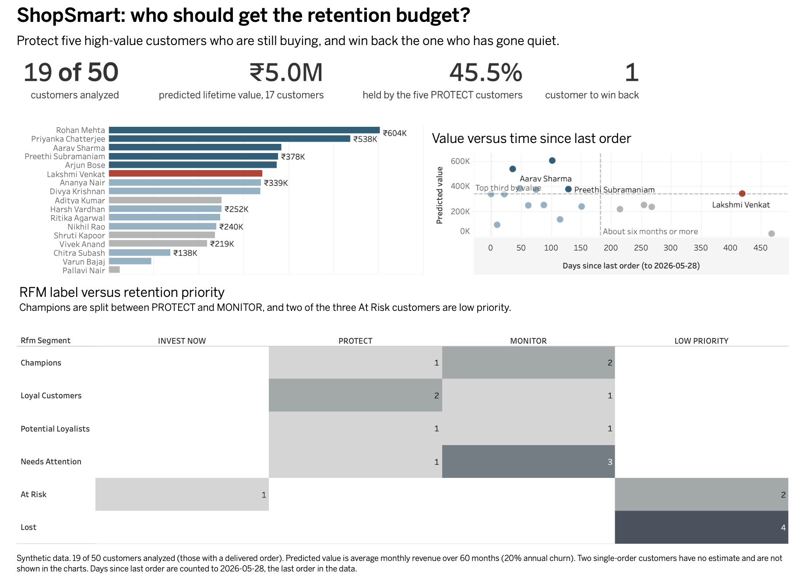
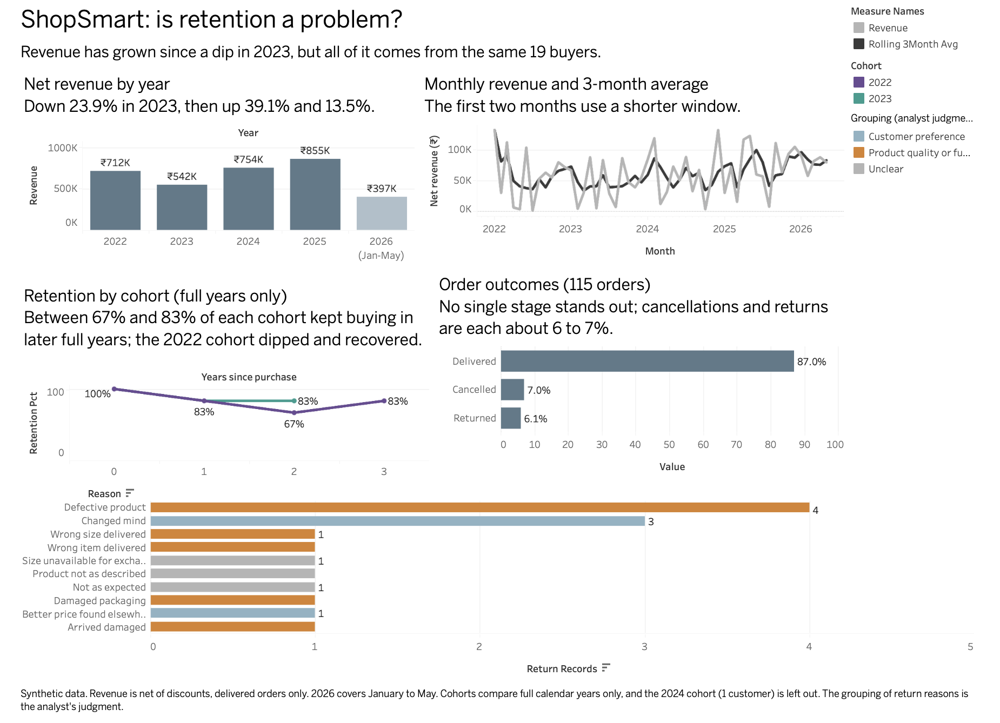
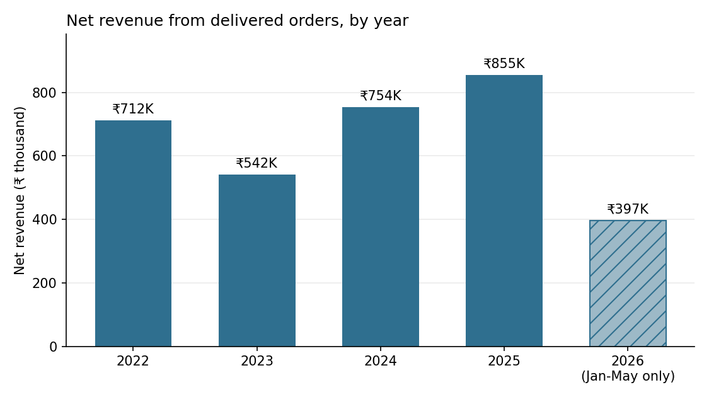

# ShopSmart retention analysis

An SQL project that decides which customers a small e-commerce business should spend its retention budget on. Eight analyses feed one final table that ranks customers by predicted value and flags the ones drifting away.

The data is synthetic: a six-table MySQL database I designed, with 50 customers and 115 orders from 2022 to 2026.

Tools: MySQL 8, CTEs, window functions (`LAG`, `NTILE`, `AVG() OVER`), self-joins, conditional aggregation. Tableau Public for the dashboards.

## The question

Which customers should ShopSmart invest retention budget in, and why?

## The answer

Put most of the budget into five customers who are high in predicted value and still buying: Rohan Mehta, Priyanka Chatterjee, Aarav Sharma, Preethi Subramaniam and Arjun Bose. They account for 45.5% of the total predicted lifetime value in the data (₹5.0M). Add one win-back effort for Lakshmi Venkat, the only high-value customer who has gone quiet; her last order was 419 days before the end of the data. Spend little on the rest. The data has no campaign cost or response rate for individual customers, so this ranks who deserves attention and does not size a budget.

| Priority | Customers | Share of predicted value | Meaning |
|---|---|---|---|
| INVEST NOW | 1 | 6.8% | High value, no recent order |
| PROTECT | 5 | 45.5% | High value, still buying |
| MONITOR | 7 | 33.0% | Lower value, still buying |
| LOW PRIORITY | 6 | 14.6% | Lower value, no recent order |

Two customers who ordered only once have no value estimate and sit in LOW PRIORITY; the shares are out of the total for the other 17.

Using RFM labels alone would have pointed the budget at the wrong people. Two of the three customers labeled Champions (Ananya Nair and Divya Krishnan) rank below five customers with other labels and are only worth monitoring.

The INVEST NOW group has one customer because of where the top-third cutoff falls. Lakshmi's predicted value (₹343K) is about 1% above the next customer's (₹339K). She is the clearest case, not necessarily the only one.

Revenue is not falling, so the case for retention is not a sales decline. Net revenue grew in each of the last three periods (details below), but it rests on the same 19 buyers, and no customer has made a first delivered purchase since February 2024.

## Dashboards

Two Tableau Public dashboards present the results. They read the CSV files in `results/` and calculate nothing new, so every figure matches the sections below. Click an image to open the live dashboard.

[Dashboard 1: who should get the retention budget?](https://public.tableau.com/app/profile/plabon.roy4287/viz/ShopSmartretentionanalysis/Dashboard1)

[](https://public.tableau.com/app/profile/plabon.roy4287/viz/ShopSmartretentionanalysis/Dashboard1)

[Dashboard 2: is retention a problem?](https://public.tableau.com/app/profile/plabon.roy4287/viz/ShopSmartretentionanalysis/Dashboard2)

[](https://public.tableau.com/app/profile/plabon.roy4287/viz/ShopSmartretentionanalysis/Dashboard2)

## Data

| Table | Rows | Contents |
|---|---|---|
| customers | 50 | Name, city, country, segment, signup date |
| products | 30 | Category, sub-category, price, cost |
| orders | 115 | Date, status, payment method |
| order_items | 131 | Product, quantity, unit price, discount |
| returns | 15 | Item-level returns with a reason |
| marketing_campaigns | 10 | Channel, dates, budget, reach |

Orders run from 2022-01-10 to 2026-05-28. Statuses are Delivered (100), Cancelled (8) and Returned (7). The `marketing_campaigns` table and the `segment` column in `customers` are not used in this analysis.

Revenue throughout means net revenue: `unit_price * quantity * (1 - discount / 100)`, counted on delivered orders unless a section says otherwise.

Only 19 of the 50 customers can be analyzed. 29 never placed an order, and 2 placed orders that were all cancelled or returned, so they have nothing to score. Every customer-level result below is about those 19 people.

## Sections

Each file starts with a comment block stating the question, the choices made and the known limits.

| File | Question | Techniques |
|---|---|---|
| `00_data_overview_sanity_checks.sql` | Is the data clean enough to trust? | Row counts, anti-joins, range checks |
| `01_revenue_health_check.sql` | Is revenue growing? | CTE, `AVG() OVER`, `LAG` |
| `02_retention_diagnosis.sql` | Do customers keep buying? | Cohorts, retention rates |
| `03_customer_segmentation.sql` | Who are the customers? | RFM with `NTILE`, `CASE` |
| `04_customer_value.sql` | What is each customer worth? | CLV, churn-based lifespan |
| `05_funnel_analysis.sql` | Where do orders fail, and why? | Conditional aggregation |
| `06_market_basket.sql` | What is bought together? | Self-join |
| `07_final_synthesis.sql` | Who gets the budget? | Chained CTEs, `NTILE`, `CASE` |

## Findings

### Revenue (01)

Net revenue from delivered orders was ₹712K in 2022, ₹542K in 2023, ₹754K in 2024 and ₹855K in 2025. That is a 23.9% drop in 2023, followed by growth of 39.1% and 13.5%. January to May 2026 came to ₹397K, 11.1% above the same months of 2025. Every one of the 53 months in the data has at least one delivered order, so the year-over-year comparison lines up with calendar months. With only 19 buyers, a few large purchases can move a whole year, so the trend is more reliable than any single figure.



2026 covers January to May only.

### Cohorts and retention (02)

Customers are grouped by the year of their first delivered order: 12 in 2022, 6 in 2023 and 1 in 2024. Monthly cohorts were tried first and nearly all held a single customer; quarterly cohorts were still too small. The 2024 cohort is shown but not interpreted.

The 2022 cohort had 83% of its customers active in the following calendar year, 67% in the second and 83% in the third. That dip followed by a recovery suggests customers who go quiet sometimes come back, which a simple churn model does not assume. The 2023 cohort kept 83% in both of its full years. The last column of every cohort is 2026, which has only five months of data, so it is understated and left out of the comparison.

### RFM segments (03)

Customers are scored 1 to 3 on recency, frequency and spend. I used three buckets instead of five because 19 customers split five ways leaves three or four per bucket. The segment rules are written on the individual scores, not their sum, because in a sum a high spend score can hide a low frequency score. I wrote them by hand against the score combinations that actually occur and checked that they cover all 19 customers without overlap.

The result: 3 Champions, 3 Loyal customers, 2 Potential loyalists, 3 At risk, 4 Needs attention and 4 Lost. The Lost group is mixed. Vikram Singh and Rahul Verma ordered once, 1,500 and 1,351 days before the end of the data. Vivek Anand ordered 215 days before it and is in the group only because his frequency and spend are low compared with the others.

### Customer lifetime value (04)

CLV is average order value times purchase frequency times lifespan. Order value and frequency come from each customer's own history. Lifespan is the same for everyone: 1 divided by the annual churn rate. Churn is 1 minus the average retention across full calendar years of the 2022 and 2023 cohorts, which gives 20.00% and a lifespan of 5 years. In practice, a customer's predicted value is their average monthly revenue over 60 months. Customers with one order have no observable purchase rate and get no estimate.

Counting the partial year 2026 would give 28.57% churn and a 3.5-year lifespan. That changes every customer's value by the same factor, so rankings and priorities are identical either way.

RFM segment does not predict CLV rank. Rohan Mehta, a Loyal customer, is first at ₹604K. Aarav Sharma, a Champion, is third, and the other two Champions are seventh and eighth. RFM ranks customers against each other; CLV measures rupees.

### Order funnel (05)

Of 115 orders, 107 (93.04%) were not cancelled and 100 (86.96%) were delivered. 8 orders (6.96%) were cancelled and 7 (6.09%) were returned. No single stage stands out.

The 15 return records give these reasons. Eight point to product quality or fulfillment: defective product (4), arrived damaged, damaged packaging, wrong item and wrong size. Three are unclear and four are customer preference: changed mind (3) and better price elsewhere. The grouping is my judgment. Returns are rare, but the ones that happen are mostly within ShopSmart's control.

The returned orders belong to five customers. Four are still ordering, with a last delivered order between 0 and 151 days before the end of the data, and the fifth has no delivered order. I found no evidence that fulfillment problems drive churn in this data. With four customers, that is a weak check and not proof.

### Market basket (06)

Only 11 of the 107 eligible orders (delivered or returned) contain two items, and none contain more, so at most 11 product pairs exist. The query found five. Atomic Habits and The Psychology of Money appear together three times, and it is the only pair that makes obvious sense. Three of the five pairs involve boAt Airdopes 141 (7 of the 11 co-purchases), which probably reflects the small sample. This section demonstrates the technique and should not be read as a recommendation.

### How the priorities are set (07)

Each customer gets a value tier (top, middle or bottom third of predicted CLV) and their recency score. Top tier and least recent is INVEST NOW. Top tier and more recent is PROTECT. The lower tiers are MONITOR when the customer is still recent and LOW PRIORITY when not.

## Limitations

- 19 customers is a small base. Segment sizes are two to four people, so everything here is descriptive.
- The data is synthetic. The patterns show how the method works, not how real shoppers behave.
- Predicted CLV assumes a customer keeps buying at their past monthly rate for five years. For Lakshmi Venkat, who has been silent for 419 days, it is the value at stake if she is retained, not a forecast that she will stay. Short histories also make estimates noisier: Priyanka Chatterjee ranks second on four orders over 26 months.
- The churn formula assumes customers who leave never return, and the 2022 cohort shows some do.
- The data ends in May 2026, so 2026 is a partial year in every time-based result.
- Priority tiers depend on cutoffs. A one-position change at the top-third boundary would change the INVEST NOW group.
- Returns are counted at order level in the funnel. One order has an item-level return while its status is still Delivered.

## Method notes

- Recency is measured from the last order in the data (2026-05-28), so results do not change with the run date.
- Several customers share the same order count, and `NTILE` splits ties arbitrarily. Every `NTILE` ends with a tiebreaker (frequency ties are broken by spend, then customer ID), and sorted outputs are tie-broken the same way.
- Status filters differ on purpose. Revenue sections use delivered orders, the funnel uses all orders, and the market basket uses delivered and returned orders, since a returned order was still a purchase decision.

## Repository

```
shopsmart-retention-analysis/
├── README.md
├── schema/
│   └── shopsmart_setup.sql
├── sql/
│   ├── 00_data_overview_sanity_checks.sql
│   ├── 01_revenue_health_check.sql
│   ├── 02_retention_diagnosis.sql
│   ├── 03_customer_segmentation.sql
│   ├── 04_customer_value.sql
│   ├── 05_funnel_analysis.sql
│   ├── 06_market_basket.sql
│   └── 07_final_synthesis.sql
├── results/
│   └── one CSV per query, named after its SQL file
└── docs/
    ├── dashboard1.png
    ├── dashboard2.png
    └── revenue_by_year.png
```

## How to run

1. Use MySQL 8.0 or later, since the queries use CTEs and window functions. I wrote them in MySQL and also ran them on MariaDB 10.11.
2. Run `schema/shopsmart_setup.sql`. It begins with `DROP DATABASE IF EXISTS shopsmart`, so it replaces any database with that name. It then builds and fills the six tables.
3. Run the files in `sql/` in order. Each one runs on its own, and the numbering follows the order of the analysis.

From a terminal: `mysql -u root -p shopsmart < sql/07_final_synthesis.sql`

The `results/` folder has the output of every query as CSV. A blank cell means NULL.

## Out of scope

- Advanced market basket measures (support, confidence, lift).
- Why 29 customers never ordered. That is an acquisition question, not a retention one.
- Sizing the budget, since the data has no per-customer cost or response rate.
- Comparing the RFM segments with the `segment` column already in `customers`.

## About

Plabon Roy, BBA Business Analytics student at Chandigarh University, India.
LinkedIn: <add your link> | Email: <add your email>
